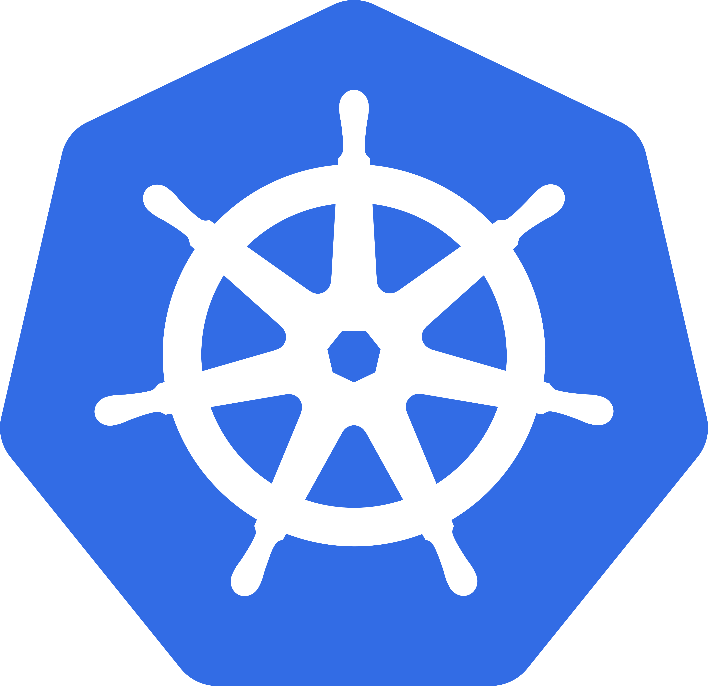

  

<h1 align="center">Kubernetes Course Tasks</h1>

This repo is my practice for my Kubernetes learning journey. I'm following the Kubernetes course from the [MLOps MENA Community](https://github.com/MLOpsMENACommunity), and every task I finish goes here: the YAML files, what I ran, screenshots, and the problems I hit along the way.

Everything runs on a local 3-node minikube cluster on my Windows machine.

## Tasks

| Task | What I built | My solution |
|------|--------------|-------------|
| Task 1 | A page served by nginx, using an init container and a sidecar in the same Pod | [Task-1](Task-1/) |
| Task 2 | A FastAPI + MySQL guestbook with a ConfigMap, a Secret, a PV/PVC and an Ingress | [Task-2](Task-2/) |

The `task-session-1` and `task-session-2` folders are the original task descriptions and starter files from the course. The `Task-1` and `Task-2` folders are my own work: the manifests, the README for each task, and the screenshots.

## How each task folder is organized

- The YAML files I wrote
- A README that explains the steps in simple words
- Screenshots of the commands and the results

If something went wrong, I wrote it down too. The Task 2 README has a whole section about a MySQL `Access denied` error that took me a while to figure out.

## Tools I use

- minikube (3 nodes)
- kubectl
- Docker
- Git Bash on Windows

## Note

I'm still learning, so some things may not be perfect. I'll keep adding the next tasks here as I go.
