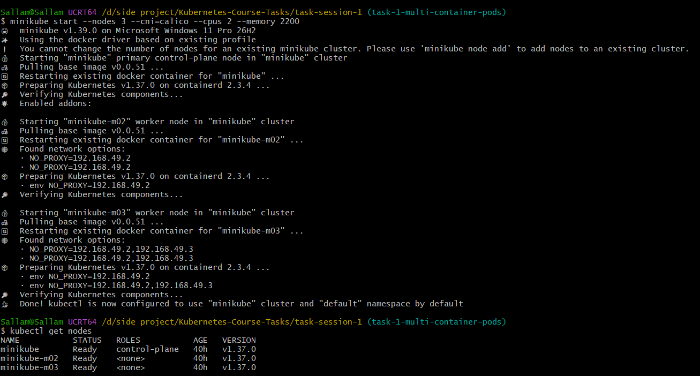
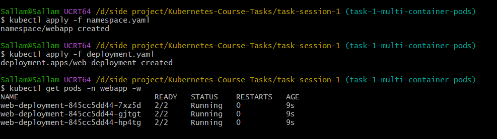
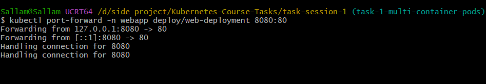
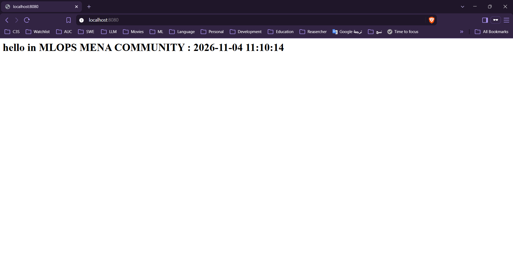
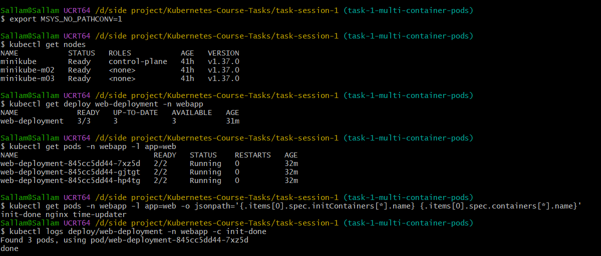
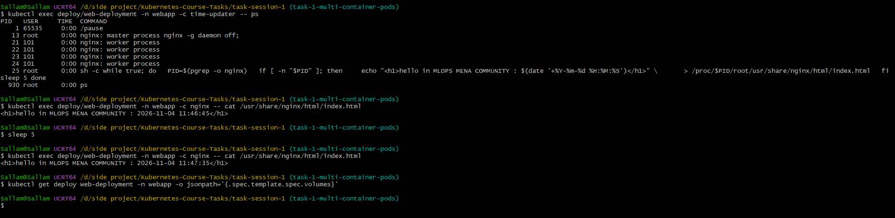
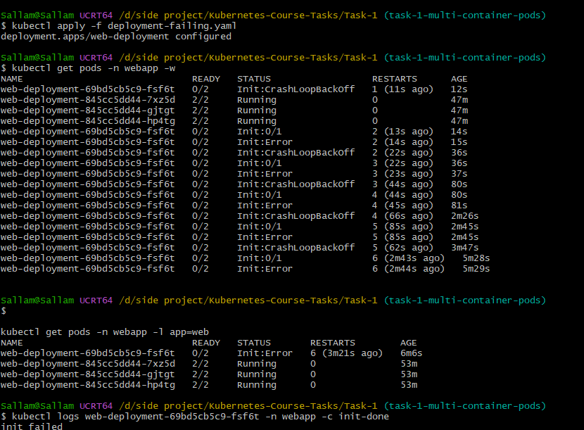
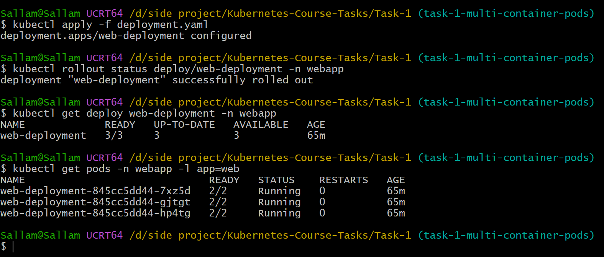

# Task 1: Multi-container Pods (Init Container & Sidecar)

In this task I run a small nginx "hello" page on a 3-node minikube cluster. The page shows the current time and the time changes every 5 seconds.

Every Pod has 3 containers (and no volume):

| Container | Type | What it does |
|-----------|------|--------------|
| `init-done` | Init container | Prints `done` and exits. The other two containers wait until it finishes OK. |
| `nginx` | Main container | Writes `index.html` with the time, then serves it on port 80. |
| `time-updater` | Sidecar | Rewrites `index.html` with the new time every 5 seconds. |

How can the sidecar change a file inside the nginx container without a shared volume? The Pod has `shareProcessNamespace: true`, so the sidecar can see the nginx process. It writes the file through `/proc/<nginx-pid>/root/...`. For that it needs the `SYS_PTRACE` capability.

At the end I make the init container fail on purpose to see what Kubernetes does.

## Files

| File | What it is |
|------|-----------|
| `namespace.yaml` | Creates the `webapp` namespace. |
| `deployment.yaml` | The working Deployment (3 replicas). |
| `deployment-failing.yaml` | Same Deployment, but the init container exits with code 1 (used in Step 5). The task doesn't ask for this file: it says to edit the init command in `deployment.yaml` and apply it again. I kept the failing version as a separate file so I could switch between the working and failing versions without editing anything. |

## Step 1: Create the cluster

```bash
minikube start --nodes 3 --cni=calico --cpus 2 --memory 2200
kubectl get nodes
```

- `minikube start ...` starts a local cluster with 3 nodes (1 control-plane + 2 workers). I used Calico as the network plugin because the next tasks need it.
- `kubectl get nodes` checks that all 3 nodes are `Ready`.

The cluster was already created before, so minikube just restarted it. It printed a message that I can't change the number of nodes of an existing cluster, but it already had 3, so that was fine.



## Step 2: Create the namespace and deploy

```bash
kubectl apply -f namespace.yaml
kubectl apply -f deployment.yaml
kubectl get pods -n webapp -w
```

- `kubectl apply -f namespace.yaml` creates the `webapp` namespace. I put everything of this task in it, so it is easy to delete later.
- `kubectl apply -f deployment.yaml` creates the Deployment with 3 Pods.
- `kubectl get pods -n webapp -w` lists the Pods of the namespace. `-w` means watch, so it keeps updating until I press Ctrl+C.

After a few seconds all 3 Pods are `2/2 Running`. It shows 2/2 and not 3/3 because the init container already finished, so only `nginx` and `time-updater` are counted.



## Step 3: Open the page

```bash
kubectl port-forward -n webapp deploy/web-deployment 8080:80
```

This forwards port 8080 on my laptop to port 80 of a Pod, so I can open the page in the browser. The command keeps running, so I left it open and used a second terminal for the other commands.



Then I opened http://localhost:8080 and the page shows the hello message with the time.



## Step 4: Check that everything is correct

Before this I ran `export MSYS_NO_PATHCONV=1`. I use Git Bash on Windows and it changes paths like `/usr/share/...` to a Windows path, so this line stops that.

### Nodes, Deployment, Pods and containers

```bash
kubectl get nodes
kubectl get deploy web-deployment -n webapp
kubectl get pods -n webapp -l app=web
kubectl get pods -n webapp -l app=web -o jsonpath='{.items[0].spec.initContainers[*].name} {.items[0].spec.containers[*].name}'
kubectl logs deploy/web-deployment -n webapp -c init-done
```

- `kubectl get nodes`: the 3 nodes are `Ready`.
- `kubectl get deploy ...`: READY is `3/3`, so all replicas are up.
- `kubectl get pods ... -l app=web`: `-l app=web` shows only the Pods with the label `app=web`. I have 3 Pods, each `2/2 Running`.
- The `jsonpath` command prints the container names of the first Pod. The result is `init-done nginx time-updater`, so the Pod has the init container and the two normal containers.
- `kubectl logs ... -c init-done`: shows the logs of the init container. `-c` chooses the container. It prints `done`, so the init container worked. (kubectl says "Found 3 pods, using pod/..." because I gave it the Deployment and not one Pod.)



### Sidecar, time and volumes

```bash
kubectl exec deploy/web-deployment -n webapp -c time-updater -- ps
kubectl exec deploy/web-deployment -n webapp -c nginx -- cat /usr/share/nginx/html/index.html
sleep 5
kubectl exec deploy/web-deployment -n webapp -c nginx -- cat /usr/share/nginx/html/index.html
kubectl get deploy web-deployment -n webapp -o jsonpath='{.spec.template.spec.volumes}'
```

- `kubectl exec ... -c time-updater -- ps`: runs `ps` inside the sidecar. I can see `nginx: master process` in the list. This proves the sidecar sees the nginx process (because of `shareProcessNamespace`).
- `kubectl exec ... -c nginx -- cat ...index.html`: prints the page file inside the nginx container. I ran it twice with `sleep 5` between them. The first time is `11:46:45` and the second is `11:47:35`, so the sidecar really updates the file.
- The last `jsonpath` command prints the volumes of the Pod template. It prints nothing, so there are no volumes, like the task wants.



## Step 5: Make the init container fail

Here I change only the init container command so it exits with code 1:

```yaml
command: ["sh", "-c", "echo 'init failed'; exit 1"]
```

```bash
kubectl apply -f deployment-failing.yaml
kubectl get pods -n webapp -w
kubectl get pods -n webapp -l app=web
kubectl logs web-deployment-69bd5cb5c9-fsf6t -n webapp -c init-done
kubectl describe pod web-deployment-69bd5cb5c9-fsf6t -n webapp
```

- `kubectl apply -f deployment-failing.yaml` updates the existing Deployment (I did not delete it). Kubernetes sees a change in the Pod template, so it starts a rolling update and creates one new Pod.
- `kubectl get pods -w`: I watch what happens to the new Pod. It goes `Init:0/1`, `Init:Error`, `Init:CrashLoopBackOff` and again and again. The restarts number goes up and the waiting time between tries gets longer.
- `kubectl get pods -l app=web`: the new Pod is `0/2` and the 3 old Pods are still `2/2 Running`.
- `kubectl logs <new-pod> -c init-done`: prints `init failed`, the text from my command.
- `kubectl describe pod <new-pod>`: shows the details and the events of the Pod. The Pod name is different on every cluster, I copied it from the `get pods` output.



The `describe` output is too long for a screenshot, so I pasted it here. The important parts:

- `init-done` is `Terminated` with `Reason: Error` and **`Exit Code: 1`**, and its restart count is 6.
- `nginx` and `time-updater` are both `Waiting` with `Reason: PodInitializing`, and their restart count is 0. They never started.
- Conditions: `Initialized: False`, `Ready: False`, `ContainersReady: False`.
- The last event is a warning: `Back-off restarting failed container init-done`.

<details>
<summary>Full <code>kubectl describe</code> output</summary>

```text
Name:             web-deployment-69bd5cb5c9-fsf6t
Namespace:        webapp
Priority:         0
Service Account:  default
Node:             minikube-m03/192.168.49.4
Start Time:       Wed, 04 Nov 2026 13:56:10 +0200
Labels:           app=web
                  pod-template-hash=69bd5cb5c9
Annotations:      cni.projectcalico.org/containerID: 456a84f703101c9df49d3649f0f501378178e9003d5c38503a5def258cc16d9e
                  cni.projectcalico.org/podIP: 10.244.151.5/32
                  cni.projectcalico.org/podIPs: 10.244.151.5/32
Status:           Pending
IP:               10.244.151.5
IPs:
  IP:           10.244.151.5
Controlled By:  ReplicaSet/web-deployment-69bd5cb5c9
Init Containers:
  init-done:
    Container ID:  containerd://422c854f8ae41ca977d15c780c44a4453a743d7cca2d5d49b2087601d4c5915a
    Image:         busybox:1.36
    Image ID:      docker.io/library/busybox@sha256:73aaf090f3d85aa34ee199857f03fa3a95c8ede2ffd4cc2cdb5b94e566b11662
    Port:          <none>
    Host Port:     <none>
    Command:
      sh
      -c
      echo 'init failed'; exit 1
    State:          Terminated
      Reason:       Error
      Exit Code:    1
      Started:      Wed, 04 Nov 2026 14:01:38 +0200
      Finished:     Wed, 04 Nov 2026 14:01:38 +0200
    Last State:     Terminated
      Reason:       Error
      Exit Code:    1
      Started:      Wed, 04 Nov 2026 13:58:55 +0200
      Finished:     Wed, 04 Nov 2026 13:58:55 +0200
    Ready:          False
    Restart Count:  6
    Environment:    <none>
    Mounts:
      /var/run/secrets/kubernetes.io/serviceaccount from kube-api-access-4z586 (ro)
Containers:
  nginx:
    Container ID:
    Image:         nginx:1.27
    Image ID:
    Port:          80/TCP
    Host Port:     0/TCP
    Command:
      /bin/sh
      -c
    Args:
      echo "<h1>hello in MLOPS MENA COMMUNITY : $(date '+%Y-%m-%d %H:%M:%S')</h1>" > /usr/share/nginx/html/index.html
      exec nginx -g 'daemon off;'

    State:          Waiting
      Reason:       PodInitializing
    Ready:          False
    Restart Count:  0
    Environment:    <none>
    Mounts:
      /var/run/secrets/kubernetes.io/serviceaccount from kube-api-access-4z586 (ro)
  time-updater:
    Container ID:
    Image:         busybox:1.36
    Image ID:
    Port:          <none>
    Host Port:     <none>
    Command:
      sh
      -c
    Args:
      while true; do
        PID=$(pgrep -o nginx)
        if [ -n "$PID" ]; then
          echo "<h1>hello in MLOPS MENA COMMUNITY : $(date '+%Y-%m-%d %H:%M:%S')</h1>" \
            > /proc/$PID/root/usr/share/nginx/html/index.html
        fi
        sleep 5
      done

    State:          Waiting
      Reason:       PodInitializing
    Ready:          False
    Restart Count:  0
    Environment:    <none>
    Mounts:
      /var/run/secrets/kubernetes.io/serviceaccount from kube-api-access-4z586 (ro)
Conditions:
  Type                        Status
  PodReadyToStartContainers   True
  Initialized                 False
  Ready                       False
  ContainersReady             False
  PodScheduled                True
Volumes:
  kube-api-access-4z586:
    Type:                    Projected (a volume that contains injected data from multiple sources)
    TokenExpirationSeconds:  3607
    ConfigMapName:           kube-root-ca.crt
    Optional:                false
    DownwardAPI:             true
QoS Class:                   BestEffort
Node-Selectors:              <none>
Tolerations:                 node.kubernetes.io/not-ready:NoExecute op=Exists for 300s
                             node.kubernetes.io/unreachable:NoExecute op=Exists for 300s
Events:
  Type     Reason     Age                   From               Message
  ----     ------     ----                  ----               -------
  Normal   Scheduled  6m21s                 default-scheduler  Successfully assigned webapp/web-deployment-69bd5cb5c9-fsf6t to minikube-m03
  Normal   Pulled     53s (x7 over 6m20s)   kubelet            spec.initContainers{init-done}: Container image "busybox:1.36" already present on machine and can be accessed by the pod
  Normal   Created    53s (x7 over 6m20s)   kubelet            spec.initContainers{init-done}: Container created
  Normal   Started    53s (x7 over 6m20s)   kubelet            spec.initContainers{init-done}: Container started
  Warning  BackOff    52s (x10 over 6m19s)  kubelet            spec.initContainers{init-done}: Back-off restarting failed container init-done in pod web-deployment-69bd5cb5c9-fsf6t_webapp(8cb3f11c-63ff-4f44-bf59-51ef244165a3)
```

</details>

### Answers to the questions

- **Which status does the new Pod show?** `Init:Error`, then `Init:CrashLoopBackOff`, and READY is `0/2`.
- **Do `nginx` and `time-updater` start?** No. They stay in `PodInitializing`, because a Pod starts its normal containers only after all init containers finished successfully.
- **Is the page still reachable, and why?** Yes. The Deployment does a rolling update: it removes an old Pod only after the new one is ready. The new Pod never becomes ready, so the 3 old Pods keep running and serving the page.

## Step 6: Fix it

I applied the working file again (the one with `echo done`):

```bash
kubectl apply -f deployment.yaml
kubectl rollout status deploy/web-deployment -n webapp
kubectl get deploy web-deployment -n webapp
kubectl get pods -n webapp -l app=web
```

- `kubectl apply -f deployment.yaml`: puts the working init command back.
- `kubectl rollout status ...`: waits and tells me when the update is finished. It says `successfully rolled out`.
- `kubectl get deploy ...`: READY `3/3` and UP-TO-DATE `3`.
- `kubectl get pods -l app=web`: 3 Pods, each `2/2 Running`, and the broken Pod is gone.

The Pods have the same names as in the beginning (`845cc5dd44`) and 0 restarts. I think this is because the working version is the same as the old one, so the Deployment went back to its old ReplicaSet and never touched the old Pods.



## What I learned

- Init containers run first and must succeed, otherwise the other containers never start.
- A sidecar runs next to the main container in the same Pod.
- If a new version is broken, a Deployment keeps the old Pods running, so the app stays up.
- To fix a broken update, apply a working version again.
