# Task 2: FastAPI + MySQL with ConfigMap, Secret, PV/PVC and Ingress

In this task I deploy a small **guestbook** web app on my 3-node minikube cluster (the same cluster from Task 1).

- The app is written with **FastAPI**. It shows a website and saves messages in **MySQL**.
- MySQL keeps its data on a **PersistentVolume (PV) + PersistentVolumeClaim (PVC)**, so the data is not lost when the Pod restarts.
- The app settings are in a **ConfigMap**, and the MySQL passwords are in a **Secret**.
- Users reach the app through an **Ingress**.

```
Browser -> Ingress Controller -> Ingress (webapp-ingress) -> Service webapp-api (80 -> 8000) -> 2 app Pods
                                                                                                   |
                                                                              Service mysql (3306) -> 1 MySQL Pod -> PVC -> PV (hostPath on minikube-m02)
```

The architecture diagram from the task is in [../task-session-2/images/architecture.png](../task-session-2/images/architecture.png).

## What each Kubernetes object is (in simple words)

| Object | Name | Why I need it |
|--------|------|---------------|
| Namespace | `webapp-stack` | A folder for all the objects of this task. Easy to find and easy to delete. |
| Secret | `mysql-secret` | Stores the passwords. Kubernetes keeps the values base64-encoded. |
| ConfigMap | `webapp-config` | Stores normal (non-secret) settings like the title and the MySQL address. |
| PV | `mysql-pv` | The real storage (a folder on a node). It has **no namespace**. |
| PVC | `mysql-pvc` | A "request" for storage. The MySQL Pod uses the PVC, and the PVC is bound to the PV. |
| Deployment | `mysql` | Runs 1 MySQL Pod. |
| Service | `mysql` | A stable name/address (`mysql:3306`) for the MySQL Pod. |
| Deployment | `webapp-api` | Runs 2 app Pods. |
| Service | `webapp-api` | A stable address for the app Pods. It also load-balances between them. |
| Ingress | `webapp-ingress` | Sends the traffic coming from outside to the `webapp-api` Service. |

## Files

| File | What it is |
|------|-----------|
| `namespace.yaml` | Creates the `webapp-stack` namespace. |
| `secret.yaml` | The `mysql-secret` Secret (3 keys). |
| `configmap.yaml` | The `webapp-config` ConfigMap (5 keys). |
| `pv-pvc.yaml` | The PV and the PVC (2Gi, `storageClassName: manual`). |
| `mysql.yaml` | MySQL Deployment + Service. |
| `webapp.yaml` | App Deployment + Service. |
| `ingress.yaml` | The Ingress. |
| `Screenshot/` | The numbered screenshots used in this README. |

---

## Step 1: Build the images and load them into minikube

The images `webapp-api:task2` and `webapp-mysql:task2` don't exist on Docker Hub. I build them from the provided folders (`webapp/` and `mysql/`) and then **load** them into minikube. minikube runs its own container runtime inside its nodes, so it can't see the images from my local Docker until I load them.

```bash
cd task-session-2
minikube start
docker build -t webapp-api:task2 ./webapp
docker build -t webapp-mysql:task2 ./mysql
minikube image load webapp-api:task2
minikube image load webapp-mysql:task2
minikube image ls | grep task2
```

- `minikube start` starts the cluster if it is stopped.
- `docker build -t name:tag ./folder` builds an image from the `Dockerfile` in that folder.
- `minikube image load` copies the image into the minikube nodes.
- `minikube image ls` lists the images that minikube has, so I can check that both are there.

In the Deployments I use `imagePullPolicy: IfNotPresent`, so Kubernetes uses the loaded image and does **not** try to download it.

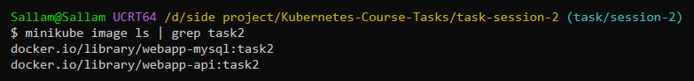

## Step 2: Check the node names

The PV uses a folder on one node, so I need the exact node name.

```bash
kubectl get nodes -L kubernetes.io/hostname
```

`-L kubernetes.io/hostname` adds a column with the node label I will use in the PV. The worker I use is `minikube-m02`.

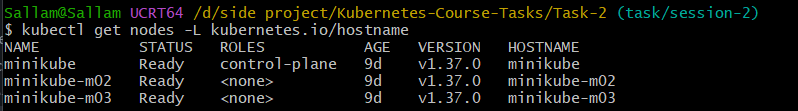

## Step 3: Create the objects (apply the YAML files)

The order matters: the namespace first, then the Secret, ConfigMap and PV/PVC, and the Deployments last. The Deployments read the Secret and the ConfigMap, so those must exist before the Pods start.

```bash
kubectl apply -f namespace.yaml
kubectl apply -f secret.yaml
kubectl apply -f configmap.yaml
kubectl apply -f pv-pvc.yaml
kubectl apply -f mysql.yaml
kubectl apply -f webapp.yaml
kubectl apply -f ingress.yaml
```

`kubectl apply -f file.yaml` creates the objects in the file (or updates them if they exist).

In the screenshot there is one error: `configmap.yaml\`. I typed a `\` at the end of the file name by mistake, so kubectl couldn't find the file. I fixed the typo and ran it again.

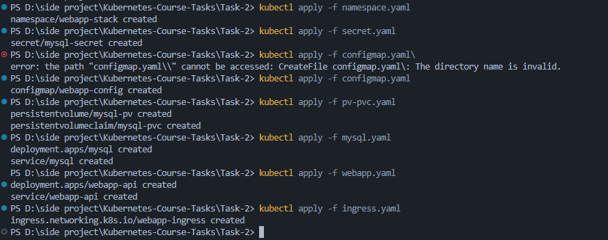

### What is inside each file

**`secret.yaml`**: `mysql-secret` has three keys: `root-password`, `app-user` and `app-password`. I used `stringData`, so I can write the values as plain text and Kubernetes encodes them for me.

**`configmap.yaml`**: `webapp-config` has five keys: `APP_TITLE`, `APP_ENV`, `MYSQL_HOST`, `MYSQL_PORT` and `MYSQL_DATABASE`. `MYSQL_HOST` is `mysql`, which is the **name of the MySQL Service**. Inside a namespace, a Service name works as a DNS name, so the app finds MySQL without an IP.

> Note: `MYSQL_PORT` must stay in the ConfigMap. Kubernetes automatically creates an env variable for every Service, and for the Service `mysql` it creates `MYSQL_PORT=tcp://10.x.x.x:3306`. The app can't use that value. The ConfigMap value (`3306`) replaces it.

**`pv-pvc.yaml`**:
- The PV `mysql-pv` is 2Gi and uses `hostPath` `/data/webapp-mysql` (a folder on the node).
- `storageClassName: manual` is on both the PV and the PVC. A PVC binds only to a PV with the **same** class. If I forget it, minikube uses its default class `standard` and creates a different volume.
- `persistentVolumeReclaimPolicy: Retain` keeps the data when the PVC is deleted.
- `nodeAffinity` pins the PV to `minikube-m02`. A `hostPath` folder exists on **one node only**. Without the pin, the MySQL Pod could start on another node after a restart, find an empty folder, and "lose" the data.
- The PVC `mysql-pvc` points to the PV with `volumeName: mysql-pv`.

**`mysql.yaml`**:
- 1 replica and `strategy: Recreate`. Recreate stops the old Pod before starting the new one. Two MySQL servers must never use the same data folder.
- The passwords come from the Secret (`secretKeyRef`). The database name comes from the ConfigMap (`configMapKeyRef`).
- The PVC is mounted at `/var/lib/mysql`, where MySQL keeps its data.
- The readiness probe runs `mysqladmin ping`. The Pod receives traffic only when MySQL answers. The liveness probe has `initialDelaySeconds: 60` because the first start takes time.
- The Service `mysql` is a ClusterIP on port 3306.

**`webapp.yaml`**:
- 2 replicas. All the keys of the ConfigMap enter the container with `envFrom`. `MYSQL_USER` and `MYSQL_PASSWORD` come from the Secret.
- Readiness and liveness probes call `GET /health` on port 8000.
- The Service `webapp-api` maps port `80` to the container port `8000`.

**`ingress.yaml`**: `ingressClassName: nginx`, path `/` with `pathType: Prefix`, and the backend is the Service `webapp-api` on port 80.

## Step 4: Install the Ingress Controller

An Ingress object is only a set of rules. It needs an **Ingress Controller** (a Pod running nginx) to apply those rules. I used the minikube addon.

```bash
minikube addons enable ingress
kubectl get pods -n ingress-nginx
kubectl get ingressclass
```

The controller Pod is `Running` and the IngressClass `nginx` exists. The two `Completed` Pods are one-time jobs that prepared the certificates, so it is normal that they are not running.

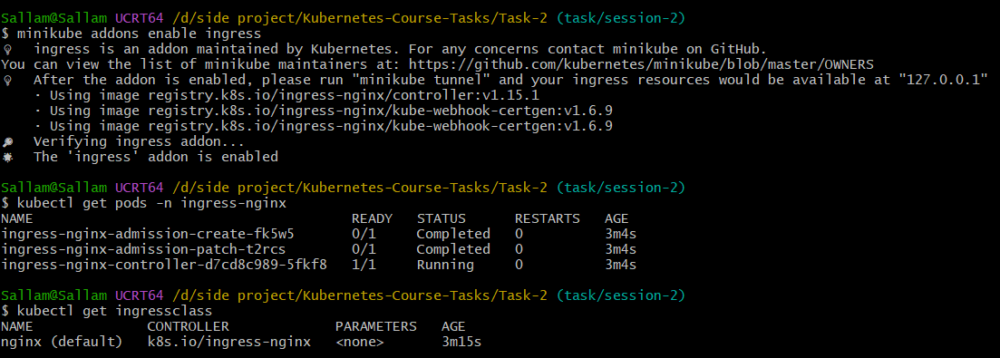

## Step 5: Verify the objects

### 5.1 Secret and ConfigMap

```bash
kubectl get secret mysql-secret -n webapp-stack
kubectl get configmap webapp-config -n webapp-stack
```

The Secret has `3` keys and the ConfigMap has `5` keys.

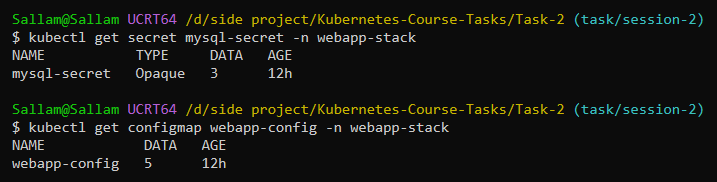

### 5.2 PV and PVC

```bash
kubectl get pv mysql-pv
kubectl get pvc mysql-pvc -n webapp-stack
```

Both are `Bound` and `2Gi`. The PV shows `CLAIM webapp-stack/mysql-pvc`, so they are connected.

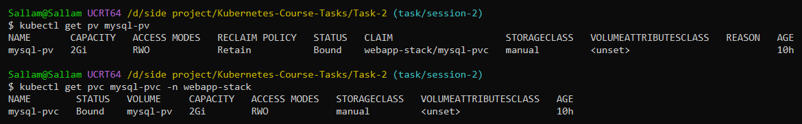

### 5.3 Deployments, Pods and Services

```bash
kubectl get deploy -n webapp-stack
kubectl get pods -n webapp-stack -o wide
kubectl get svc,endpoints -n webapp-stack
```

- `mysql` is `1/1` and `webapp-api` is `2/2`.
- The MySQL Pod runs on `minikube-m02`, the node where the PV folder is. This is what `nodeAffinity` guarantees.
- The endpoints show 1 IP for `mysql` (port 3306) and 2 IPs for `webapp-api` (port 8000). It means the Services found their Pods.

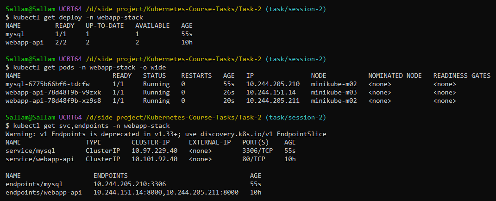

### 5.4 Environment variables of the app

```bash
kubectl exec -n webapp-stack deploy/webapp-api -- env | grep -E "APP_|MYSQL_"
```

`kubectl exec` runs a command inside a Pod. The output shows the values from the ConfigMap (`APP_TITLE`, `MYSQL_HOST=mysql`, ...) and from the Secret (`MYSQL_USER`, `MYSQL_PASSWORD`). `MYSQL_PORT=3306` is correct and is not the `tcp://...` value.

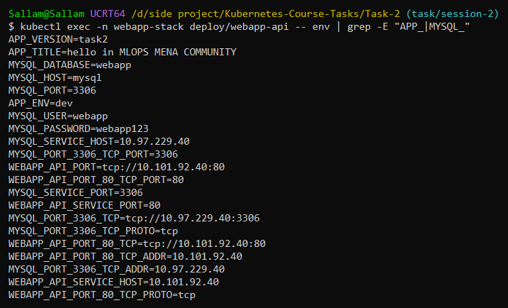

### 5.5 Default data in MySQL

```bash
kubectl exec -n webapp-stack deploy/mysql -- sh -c 'mysql -uroot -p"$MYSQL_ROOT_PASSWORD" -e "SELECT user,host FROM mysql.user; SELECT * FROM webapp.messages"'
```

The user `webapp` exists and the table `webapp.messages` has the 2 default messages. They were created by the init script of the MySQL image on the first start.

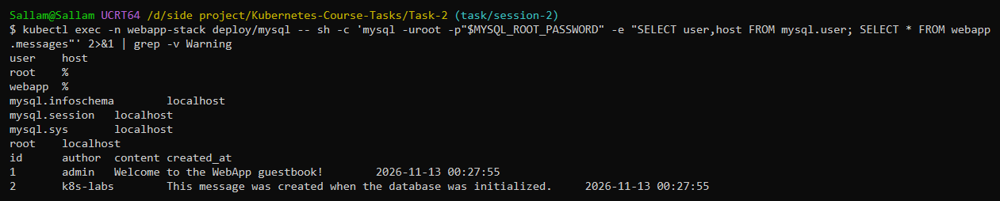

### 5.6 Ingress

```bash
kubectl get ingress webapp-ingress -n webapp-stack
```

The class is `nginx` and the ADDRESS is filled, so the controller accepted the Ingress.

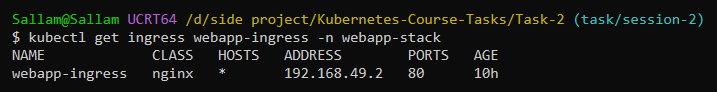

## Step 6: Open the app

My cluster uses the Docker driver on Windows, so I can't open the minikube IP directly from the browser. I use `port-forward` to the Ingress Controller. I leave it running in a second terminal.

```bash
kubectl port-forward -n ingress-nginx svc/ingress-nginx-controller 8080:80
```

Then I open <http://localhost:8080>. The page shows the title from the ConfigMap (`hello in MLOPS MENA COMMUNITY`), the environment `dev`, the app Pod that answered, and the MySQL Pod. I wrote some messages in the guestbook and they are saved. If I refresh the page, the app Pod name can change. It is the Service load-balancing between the 2 Pods.

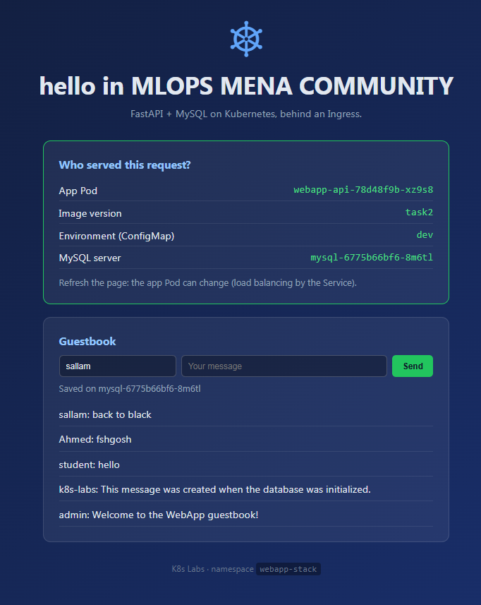

## Step 7: Test the API with curl

```bash
curl http://localhost:8080/api/info
curl -X POST http://localhost:8080/api/messages -H "Content-Type: application/json" -d '{"author":"student","content":"hello"}'
curl http://localhost:8080/api/messages
```

`/api/info` returns `"version": "task2"`, the title, `"environment": "dev"` and the MySQL server name, so the app really reached the database.

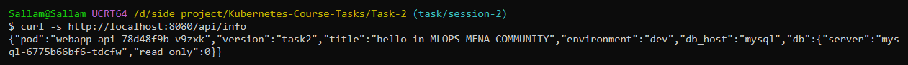

The POST returns the new message `id` (3, because 1 and 2 are the defaults) and the MySQL Pod that wrote it. The GET returns my message and the 2 default ones.

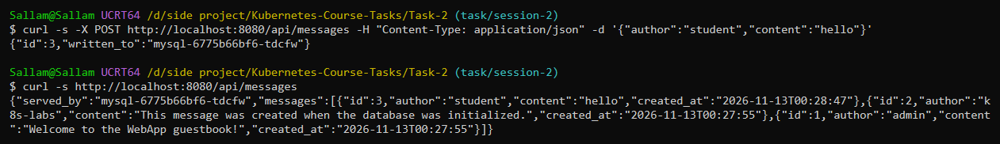

## Step 8: Prove that the data survives a restart

This is the reason for the PV. I delete the MySQL Pod. The Deployment creates a new one, and the new Pod mounts the same PVC.

```bash
kubectl delete pod -n webapp-stack -l app=mysql
kubectl get pods -n webapp-stack -l app=mysql -o wide
curl http://localhost:8080/api/messages
```

The Pod name changed (a new Pod), it is on `minikube-m02` again, and my message (`id 3`) is still there.

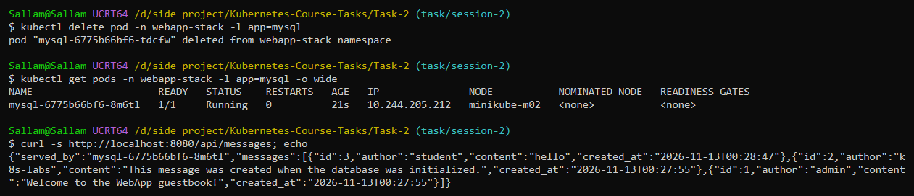

---

## The problem I faced: `Access denied for user 'webapp'`

### Symptom

After everything was deployed, the page showed the MySQL server as an error, and the guestbook said "Database not ready yet":

```
error: (1045, "Access denied for user 'webapp'@'10.244.151.10' (using password: YES)")
```

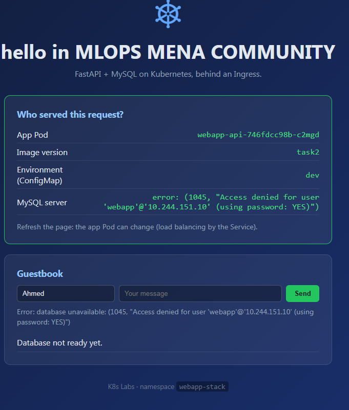

### First idea (it was not enough)

The MySQL image creates the database and the `webapp` user **only on the first start**, when the data folder is empty. If the folder already has data, MySQL skips that step. So I thought the folder had old data from a previous run with different passwords. I looked at the folder on the node and it had many MySQL files:

```bash
minikube ssh -n minikube-m02 -- "sudo ls -la /data/webapp-mysql"
```

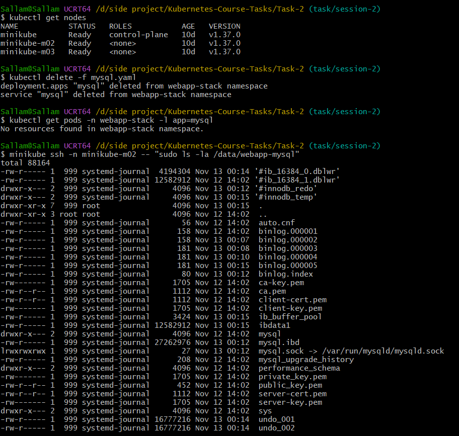

I deleted the Deployment, deleted the folder and applied again. The error did not go away:

```bash
kubectl delete -f mysql.yaml
minikube ssh -n minikube-m02 -- sudo rm -rf /data/webapp-mysql
kubectl apply -f mysql.yaml
```

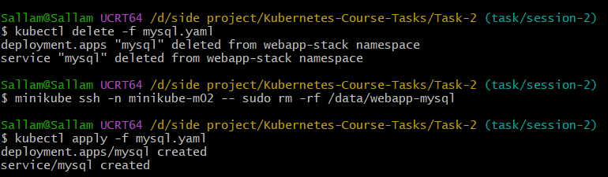

Two things helped me to understand why:
- I wiped the folder while the old Pod could still be running or terminating. I should wait until `kubectl get pods` shows no MySQL Pod before I delete the files.
- The MySQL Pod showed `RESTARTS 1` just a few seconds after it started. A healthy Pod should not restart. That meant something crashed during the first start.

### Finding the real cause

`kubectl logs` shows the **current** container, which was already the second start. The crash was in the **previous** container, so I read its logs:

```bash
kubectl logs deploy/mysql -n webapp-stack --previous
kubectl describe pod -n webapp-stack -l app=mysql | grep -A8 "Last State"
```

The important lines were:

```
running /docker-entrypoint-initdb.d/01-setup.sh
/docker-entrypoint-initdb.d/01-setup.sh: /bin/bash^M: bad interpreter: No such file or directory
...
Last State: Terminated   Reason: Error   Exit Code: 126
```

`^M` is the invisible `\r` character of **Windows line endings (CRLF)**. Git on Windows (`core.autocrlf=true`) converted the init script from LF to CRLF. Linux then looked for a program called `/bin/bash\r`, which doesn't exist. So the init script crashed (exit code 126), and the database `webapp` and the user `webapp` were never created. MySQL restarted and kept the half-initialized data, which is why the app got `Access denied`. My YAML files were fine: the bug was inside the image.

### Fix, part 1: line endings

I converted the script to LF:

```bash
sed -i 's/\r$//' mysql/initdb/01-setup.sh
```

After rebuilding the image, there was a **second** error, in the log of the previous container:

```
01-setup.sh: line 9: mysql_note: command not found
01-setup.sh: line 10: docker_process_sql: command not found
```

### Fix, part 2: file permissions

The official MySQL entrypoint treats `.sh` files in two ways:
- **Not executable**: it *sources* the file (loads it inside itself). The helper functions `mysql_note` and `docker_process_sql` exist, so the script works.
- **Executable**: it *runs* the file as a new process. The helper functions don't exist there, so the script fails.

Docker on Windows copies files into the image as executable (755). On Linux the same file would be 644, so the problem appears only on Windows. I fixed it in `task-session-2/mysql/Dockerfile`, with `--chmod=644`:

```dockerfile
COPY --chmod=644 initdb/01-setup.sh /docker-entrypoint-initdb.d/01-setup.sh
```

### Rebuild and redeploy

```bash
docker build -t webapp-mysql:task2 ./mysql
minikube image load webapp-mysql:task2 --overwrite=true

kubectl delete -f mysql.yaml
kubectl get pods -n webapp-stack -l app=mysql          # wait until: No resources found
minikube ssh -n minikube-m02 -- "sudo rm -rf /data/webapp-mysql/*"
minikube ssh -n minikube-m02 -- "sudo ls -la /data/webapp-mysql"   # must be empty
kubectl apply -f mysql.yaml

kubectl rollout restart deploy/webapp-api -n webapp-stack
```

- I rebuild the image and load it again. The cluster still had the old image with the broken script.
- I wait until the old Pod is gone, then I empty the folder, so MySQL sees an empty folder and runs the init script.
- I restart the app Pods so they connect again.

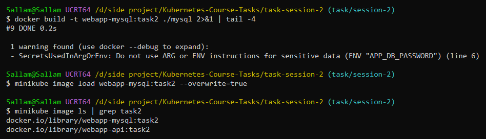

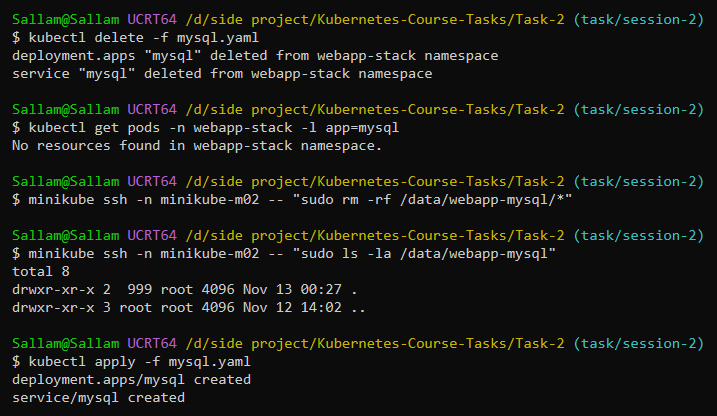

Now the log shows the init script being **sourced** and the database and the user being created, and the Pod has `RESTARTS 0`:

```bash
kubectl logs deploy/mysql -n webapp-stack | grep -E "Initializing|initdb|Creating database|ready for connections"
```

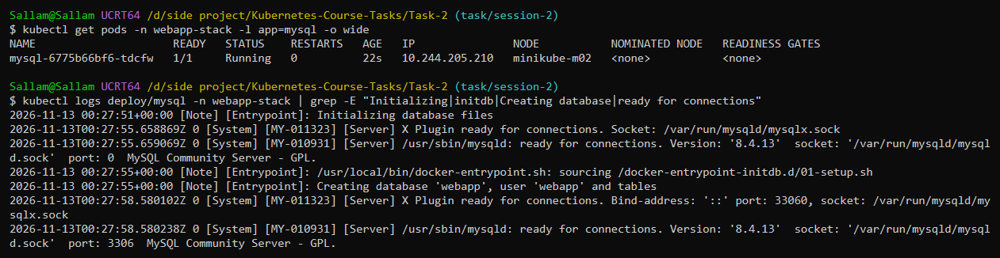

After this, all the checks of Steps 5 to 8 passed.

### What I learned

1. `Access denied` was only the symptom. The cause was in the MySQL Pod logs. I should check `kubectl logs` and `kubectl logs --previous` **early**.
2. `RESTARTS` greater than 0 on a new Pod is a warning sign, so look at `--previous` and `kubectl describe pod`.
3. Files created on Windows can break Linux containers (CRLF line endings, executable bit). Adding a `.gitattributes` file with `*.sh text eol=lf` prevents the CRLF problem.
4. MySQL creates its database and user **only on the first start**. If the data folder already has data, a change in the Secret has no effect. To start again, delete the Deployment, wait until the Pod is gone, and empty the data folder.
5. If a command says `connection refused` to `127.0.0.1`, the cluster is just stopped. Run `minikube start`.

## Useful commands

```bash
kubectl get all -n webapp-stack                          # see everything in the namespace
kubectl describe pod <pod> -n webapp-stack               # events and details of a Pod
kubectl logs deploy/mysql -n webapp-stack                # logs of the current container
kubectl logs deploy/mysql -n webapp-stack --previous     # logs of the container before the restart
kubectl rollout restart deploy/webapp-api -n webapp-stack
```
