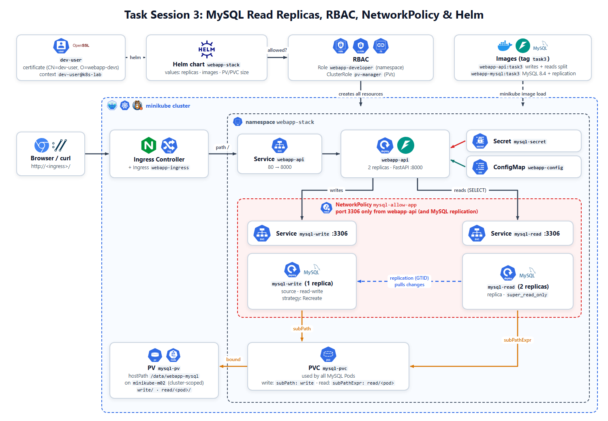

# 🗄️ Task Session 3: MySQL Read Replicas, RBAC, NetworkPolicy & Helm

## 📝 Description

Grow the Task 2 stack:

- ✍️📖 Split MySQL into **`mysql-write`** (1 replica, writes) and **`mysql-read`** (2 replicas, reads). The read servers copy every change from the write server (replication).
- 🏷️ Use new images with the tag **`task3`**. The app now sends writes and reads to different Services, so it needs a new ConfigMap.
- 👤 Deploy as a new cluster user **`dev-user`** with rights only in `webapp-stack`.
- 🛡️ Allow MySQL traffic only from the app (**NetworkPolicy**).
- ⎈ Package everything as **one Helm chart** and install it.

The new app (`webapp/`) and MySQL image (`mysql/`) are provided in this folder.

---

## 🧩 Diagram



- `dev-user` runs `helm install`; RBAC decides what the user may create.
- The app sends writes to `mysql-write` and reads to `mysql-read`. Both use one PVC, each server in its own folder.
- The NetworkPolicy opens port 3306 only to the app and to the MySQL Pods (for replication).

---

## 🧰 What You Need

- **Tools:** `minikube`, `kubectl`, `helm` (v3+), `docker`, `openssl`, a machine with **8 GB RAM** is enough (tested: about 4 GB used at the peak, with 3 MySQL servers and Argo CD)
- **From Task 2:** the running cluster with Calico, the Ingress Controller, and your YAML files
- **`task2` vs `task3` images:**

| | `task2` | `task3` |
|---|---|---|
| `webapp-api` reads the MySQL address from | `MYSQL_HOST` | `MYSQL_WRITE_HOST` (writes), `MYSQL_READ_HOST` (reads) |
| `webapp-mysql` | one server | `MYSQL_ROLE=source` (write) or `replica` (read) |

- **MySQL `task3` variables:**

| Variable | Used by | Meaning |
|----------|---------|---------|
| `MYSQL_ROLE` | both | `source` or `replica` |
| `MYSQL_ROOT_PASSWORD` | both | root password (required) |
| `APP_DB_NAME`, `APP_DB_USER`, `APP_DB_PASSWORD` | source only | database and app user |
| `MYSQL_REPL_USER` / `MYSQL_REPL_PASSWORD` | both | replication user (`repl`) and password |
| `MYSQL_SOURCE_HOST` | replica | write Service name (`mysql-write`) |
| `POD_IP` | replica | used for a unique server ID |

- **Names:**

| Resource | Name |
|----------|------|
| Namespace | `webapp-stack` (from Task 2) |
| Images | `webapp-api:task3`, `webapp-mysql:task3` |
| User / group | `dev-user` / `webapp-devs` |
| Role / RoleBinding | `webapp-developer` / `webapp-developer-binding` |
| ClusterRole / ClusterRoleBinding | `pv-manager` / `pv-manager-binding` |
| kubeconfig cluster / context | `k8s-lab` / `dev-user@k8s-lab` |
| Secret / ConfigMap / Ingress | `mysql-secret` / `webapp-config` / `webapp-ingress` |
| PV / PVC | `mysql-pv` / `mysql-pvc` |
| Deployments + Services | `mysql-write`, `mysql-read`, `webapp-api` |
| Pod labels | `app: webapp-api` · `app: mysql, role: write` · `app: mysql, role: read` |
| NetworkPolicy | `mysql-allow-app` |
| Helm chart / release | `webapp-stack` / `webapp` |

---

## 🚀 Steps

### 1. Prepare the cluster (as admin)

- Start the cluster if it is stopped, and check that Calico runs (needed for the NetworkPolicy):

  ```bash
  minikube start
  kubectl get pods -n kube-system -l k8s-app=calico-node
  ```

- Remove the Task 2 objects and the old MySQL data. Helm can't take over objects it didn't create, and the write server must start empty. Keep the namespace and your YAML files.

  ```bash
  kubectl config use-context minikube
  kubectl delete -n webapp-stack ingress/webapp-ingress \
    deploy/webapp-api deploy/mysql svc/webapp-api svc/mysql \
    configmap/webapp-config secret/mysql-secret pvc/mysql-pvc
  kubectl delete pv mysql-pv
  minikube ssh -n minikube-m02 -- sudo rm -rf /data/webapp-mysql
  ```

### 2. Build and load the `task3` images

- Run the commands from **this** task's folder: build the images with the tag `task3`, and load them into minikube next to the `task2` images.
- 💡 Keep the `task2` images: with a new tag per release, you can always go back to the old image and its config.

```bash
docker build -t webapp-api:task3 ./webapp
docker build -t webapp-mysql:task3 ./mysql
minikube image load webapp-api:task3
minikube image load webapp-mysql:task3
minikube image ls              # check: task2 and task3 images are listed
```

### 3. Create the user `dev-user`

- With `openssl`, create a private key `dev-user.key` and a signing request `dev-user.csr` with `CN=dev-user` (user) and `O=webapp-devs` (group).
- Create a `CertificateSigningRequest` named `dev-user` with the base64 of `dev-user.csr`, `signerName: kubernetes.io/kube-apiserver-client` and usage `client auth`.
- Approve it (as admin) and save the signed certificate (field `.status.certificate`, base64) as `dev-user.crt`.
- 💡 Kubernetes has no "user" object: a user is whoever presents a certificate signed by the cluster CA. The `CN` is the user name, `O` is the group.
- 💡 The subject format for `openssl req -subj` is `"/CN=<user>/O=<group>"`. In Git Bash on Windows, start the command with `MSYS_NO_PATHCONV=1`.

```bash
openssl genrsa -out dev-user.key 2048                  # private key (keep it secret)

# base64 of the CSR on one line, for spec.request
base64 < dev-user.csr | tr -d '\n'                    # Bash
[Convert]::ToBase64String([IO.File]::ReadAllBytes("dev-user.csr"))   # PowerShell

kubectl get csr                # check: CONDITION Approved,Issued
```

### 4. Give the user rights (as admin)

- Role `webapp-developer` in `webapp-stack`:

| Resources | Verbs |
|-----------|-------|
| `pods`, `services`, `configmaps`, `secrets`, `persistentvolumeclaims` | all |
| `deployments`, `replicasets` (`apps`) | all |
| `networkpolicies`, `ingresses` (`networking.k8s.io`) | all |
| `pods/log` | get |
| `pods/exec`, `pods/attach`, `pods/portforward` | get, create |
| `events`, `endpoints` | get, list, watch |

- RoleBinding `webapp-developer-binding` → `kind: User`, `name: dev-user`.
- ClusterRole `pv-manager` on `persistentvolumes` + ClusterRoleBinding `pv-manager-binding` (PVs have no namespace).

- 💡 Core objects (`pods`, `secrets`, ...) use `apiGroups: [""]`. Find the group of any object with `kubectl api-resources`.
- 💡 A Role works only in its namespace. A PV has no namespace, so it needs a ClusterRole.
- 💡 Helm saves each release as a Secret, so `dev-user` needs rights on Secrets.

```bash
kubectl api-resources | grep -E "networkpolicies|ingresses|deployments"
kubectl auth can-i create deployments -n webapp-stack --as dev-user   # yes
kubectl auth can-i create persistentvolumes --as dev-user              # yes
kubectl auth can-i get nodes --as dev-user                             # no
```

### 5. Add the user to your kubeconfig

- Add a cluster `k8s-lab` (API server address + CA `~/.minikube/ca.crt`), a user `dev-user` (certificate + key) and a context `dev-user@k8s-lab` (namespace `webapp-stack`), then switch to it.
- Use `--embed-certs=true`, so the kubeconfig doesn't depend on file paths.
- 💡 The minikube CA file is `~/.minikube/ca.crt` on Linux/macOS and `%USERPROFILE%\.minikube\ca.crt` on Windows.
- From now on, work as `dev-user`. Switch to the context `minikube` only for admin steps.

- 💡 You need 4 sub-commands of `kubectl config`: `set-cluster`, `set-credentials`, `set-context`, `use-context`.
- 💡 A context = cluster + user + default namespace.

```bash
kubectl config view --minify -o jsonpath='{.clusters[0].cluster.server}'   # API server address
kubectl config get-contexts    # check: dev-user@k8s-lab is current
kubectl auth whoami            # check: dev-user, group webapp-devs
```

### 6. Update the Secret and the ConfigMap

> 📌 In Steps 6–11 you only **write** the YAML files (in a new folder, copied from Task 2). Don't `kubectl apply` them: Helm installs them in Step 13, and Helm refuses objects it didn't create. You can test a file without creating anything:
>
> ```bash
> kubectl apply --dry-run=server -f <file>.yaml
> ```

- Start from your Task 2 files.
- Secret `mysql-secret`: add the key `replication-password` = `repl123`.
- ConfigMap `webapp-config`: remove `MYSQL_HOST`, add `MYSQL_WRITE_HOST: mysql-write` and `MYSQL_READ_HOST: mysql-read`.
- 💡 This ConfigMap belongs to the `task3` image: the `task2` image only reads `MYSQL_HOST`.

### 7. Create the PV and PVC

- Same as Task 2: `mysql-pv` (2Gi, `hostPath`, `nodeAffinity` to `minikube-m02`) and `mysql-pvc`.
- 💡 Now 3 MySQL Pods share this `hostPath` folder, so `nodeAffinity` puts all of them on `minikube-m02`.
- 💡 Skeleton (in the PV `spec`):

  ```yaml
  nodeAffinity:
    required:
      nodeSelectorTerms:
        - matchExpressions:
            - key: kubernetes.io/hostname
              operator: In
              values: [<node-name>]
  ```

### 8. Create the write server `mysql-write`

- Start from the Task 2 `mysql` Deployment and rename it (Deployment + Service) to `mysql-write`.
- 1 replica, `strategy: Recreate`, labels `app: mysql`, `role: write` (also in the selectors).
- Image `webapp-mysql:task3`, env `MYSQL_ROLE=source`, `MYSQL_REPL_USER=repl`, `MYSQL_REPL_PASSWORD` from the Secret.
- Mount `mysql-pvc` at `/var/lib/mysql` with `subPath: write`.
- 💡 `subPath` mounts only one folder of the volume: the write server sees `write/`, the read servers use other folders.
- 💡 With the new label `role: write`, the Service `selector` must also have `role: write`, otherwise it would send traffic to the read servers too.

### 9. Create the read servers `mysql-read`

- Deployment + Service `mysql-read`: 2 replicas, labels `app: mysql`, `role: read`, image `webapp-mysql:task3`.
- Env: `MYSQL_ROLE=replica`, `MYSQL_SOURCE_HOST=mysql-write`, `MYSQL_ROOT_PASSWORD`, `MYSQL_REPL_USER`, `MYSQL_REPL_PASSWORD`. Don't set `APP_DB_*`: replicas copy the data.
- `POD_NAME` and `POD_IP` from the Pod (`fieldRef`: `metadata.name`, `status.podIP`).
- Mount `mysql-pvc` at `/var/lib/mysql` with `subPathExpr: read/$(POD_NAME)`: one folder per Pod.
- 💡 Two MySQL servers can't share one data folder, and all Pods of a Deployment have the same spec. `subPathExpr` gives each Pod its own folder.
- 💡 Skeleton for a value from the Pod itself (Downward API):

  ```yaml
  - name: POD_NAME
    valueFrom:
      fieldRef:
        fieldPath: <field>
  ```

- 💡 The replica must find the write server by its **Service name**: `MYSQL_SOURCE_HOST=mysql-write`.

### 10. Update the app

- `webapp-api`: change the image to `webapp-api:task3`. The new addresses come from the ConfigMap.
- Keep the Service and the Ingress `webapp-ingress` from Task 2.
- 💡 With `envFrom`, nothing else changes in the app Deployment: the ConfigMap already gives the new keys.

### 11. Create the NetworkPolicy

- `mysql-allow-app`: `podSelector` `app: mysql`, `policyTypes: [Ingress]`.
- Allow TCP `3306` from Pods with `app: webapp-api` **and** from Pods with `app: mysql` (replication).
- 💡 Once a Pod is selected by a policy with `policyTypes: [Ingress]`, every incoming connection is blocked except what the rules allow.
- 💡 Two items under one `from:` mean **OR**:

  ```yaml
  ingress:
    - from:
        - podSelector: { matchLabels: { <key>: <value> } }
        - podSelector: { matchLabels: { <key>: <value> } }
      ports:
        - protocol: TCP
          port: <port>
  ```

### 12. Build the Helm chart

```bash
helm create webapp-stack
```

- Delete the sample files in `templates/` and copy in your files (Secret, ConfigMap, PV, PVC, `mysql-write`, `mysql-read`, `webapp-api`, NetworkPolicy, Ingress). Don't add the namespace.
- In `values.yaml`, make these variables and use them as `{{ .Values.... }}`.
- 💡 Template examples:
  - `replicas: {{ .Values.app.replicaCount }}`
  - `image: "{{ .Values.app.image.repository }}:{{ .Values.app.image.tag }}"`
  - `namespace: {{ .Release.Namespace }}`
  - `storage: {{ .Values.storage.pv.size }}`
- 💡 Wrap strings with `| quote`, for example `{{ .Values.mysql.auth.password | quote }}`.

| Value | Default |
|-------|---------|
| Replicas: `webapp-api` / `mysql-write` / `mysql-read` | `2` / `1` / `2` |
| Image (repository + tag) of each Deployment | `webapp-api:task3`, `webapp-mysql:task3`, `webapp-mysql:task3` |
| PV size / PVC size | `2Gi` / `2Gi` |

```bash
helm lint webapp-stack
helm template webapp webapp-stack -n webapp-stack     # check the rendered YAML
```

### 13. Install the chart as `dev-user`

- Install the chart as release `webapp` in `webapp-stack`, from the `dev-user` context.

- 💡 A read replica may restart once if it starts before `mysql-write` is ready; it retries by itself.

```bash
kubectl config current-context                         # check: dev-user@k8s-lab
kubectl get pods -n webapp-stack -w                    # Ctrl+C to stop
kubectl logs deploy/mysql-read -n webapp-stack         # look for the replication messages
helm list -n webapp-stack                              # check: webapp deployed
helm status webapp -n webapp-stack                     # shows the NOTES of the chart
```

- Open the app through the Ingress as in Task 2. `dev-user` can't port-forward in `ingress-nginx`, so use the admin context:

  ```bash
  kubectl --context minikube port-forward -n ingress-nginx svc/ingress-nginx-controller 8080:80   # second terminal
  ```

---

## 🔍 Verify

Run as `dev-user` unless the row says **admin**.

| # | Check | Command | Expected result |
|---|-------|---------|-----------------|
| 1 | Identity | `kubectl auth whoami` | `dev-user`, group `webapp-devs` |
| 2 | Rights inside | `kubectl auth can-i create ingresses -n webapp-stack` and `kubectl auth can-i create persistentvolumes` | `yes`, `yes` |
| 3 | No rights outside | `kubectl get nodes` | `Forbidden` |
| 4 | Release | `helm list -n webapp-stack` | `webapp`, `deployed` |
| 5 | Objects | `kubectl get deploy,svc,pvc,secret,configmap,ingress,networkpolicy -n webapp-stack` | 3 Deployments, 3 Services, `mysql-pvc`, `mysql-secret`, `webapp-config`, `webapp-ingress`, `mysql-allow-app` |
| 6 | Replicas and images | `kubectl get deploy -n webapp-stack -o wide` | `webapp-api 2/2`, `mysql-write 1/1`, `mysql-read 2/2`, tag `task3` |
| 7 | Folders (**admin**) | `minikube ssh -n minikube-m02 -- ls /data/webapp-mysql /data/webapp-mysql/read` | `read write`, one folder per read Pod |
| 8 | Replication | `kubectl exec -n webapp-stack deploy/mysql-read -- sh -c 'mysql -uroot -p"$MYSQL_ROOT_PASSWORD" -e "SHOW REPLICA STATUS\G"'` | `Replica_IO_Running: Yes`, `Replica_SQL_Running: Yes` |
| 9 | Read-only replica | `kubectl exec -n webapp-stack deploy/mysql-read -- sh -c 'mysql -uroot -p"$MYSQL_ROOT_PASSWORD" -e "CREATE DATABASE test"'` | `ERROR 1290 ... --super-read-only` |
| 10 | App config | `kubectl exec -n webapp-stack deploy/webapp-api -- env` | `MYSQL_WRITE_HOST`, `MYSQL_READ_HOST`, no `MYSQL_HOST` |
| 11 | App info | `curl http://localhost:8080/api/info` | `"version": "task3"`, `write_db` `read_only: 0`, `read_db` `read_only: 1` |
| 12 | Write / read | `curl -X POST http://localhost:8080/api/messages -H "Content-Type: application/json" -d '{"author":"student","content":"hello"}'`, then `curl http://localhost:8080/api/messages` | `written_to: mysql-write-...`, then your message with `served_by: mysql-read-...` |
| 13 | App reaches MySQL | `kubectl exec -n webapp-stack deploy/webapp-api -- python -c "import socket; socket.create_connection(('mysql-write', 3306), 3); print('connected')"` | `connected` |
| 14 | Others blocked | `kubectl run nettest -n webapp-stack --rm -it --restart=Never --image=busybox:1.36 -- nc -zv -w 3 mysql-write 3306` | Timeout |
| 15 | Helm values | `helm upgrade webapp ./webapp-stack -n webapp-stack --set <app-replicas-value>=3`, then `kubectl get deploy webapp-api -n webapp-stack` | READY `3/3` (`helm rollback webapp 1 -n webapp-stack` to undo) |

> 💡 On Windows PowerShell, use `curl.exe` instead of `curl`, and write the JSON of check 12 as `'{\"author\":\"student\",\"content\":\"hello\"}'`.

---

## 🧹 Clean Up (optional)

Keep the cluster, the images and your chart for Task 4 (Task 4 removes the release itself).

```bash
helm uninstall webapp -n webapp-stack
```

---

## 📤 Submission

To submit your task:

1. **GitHub Repository:** Create a single GitHub repository named **`Kubernetes Course Tasks`** under your GitHub account to host all course tasks.
2. **Task Folder:** Create a folder named **`Task-3`** inside this repository and place all the files and manifests you used to complete this task inside it.
3. **README with Screenshots:** Include a `README.md` file inside the `Task-3` folder documenting what was done, along with screenshots showing the commands run and the verification results.
